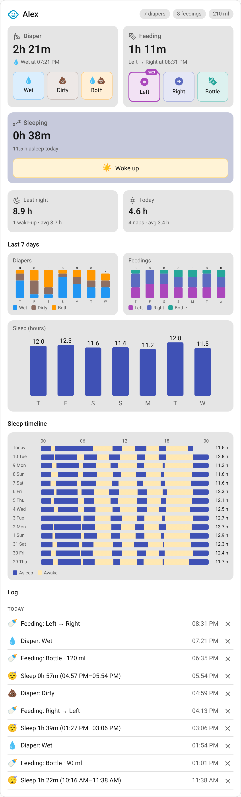
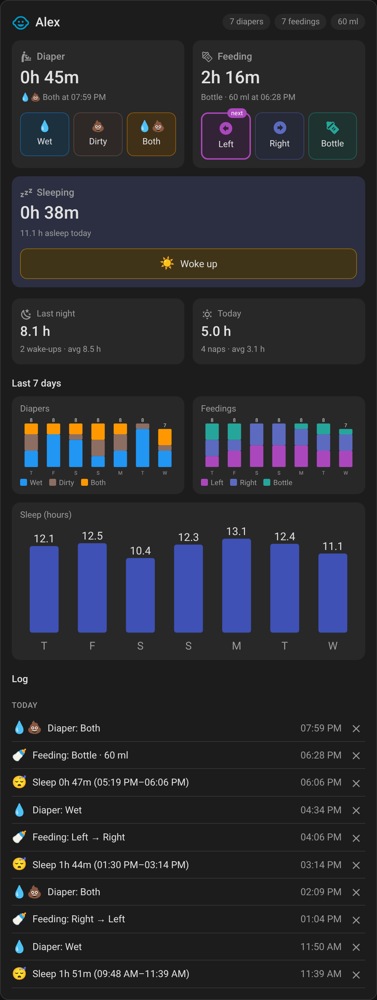
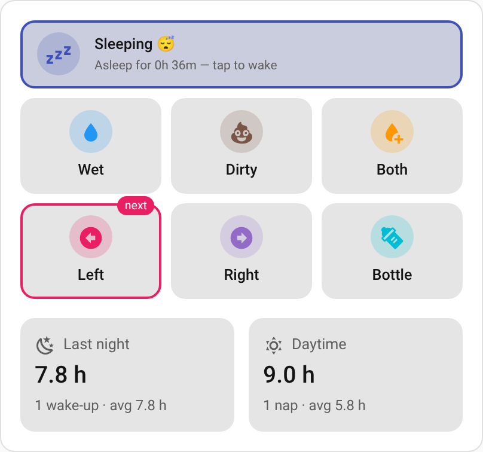
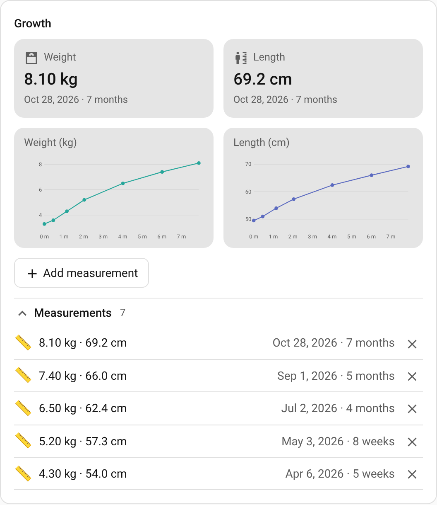
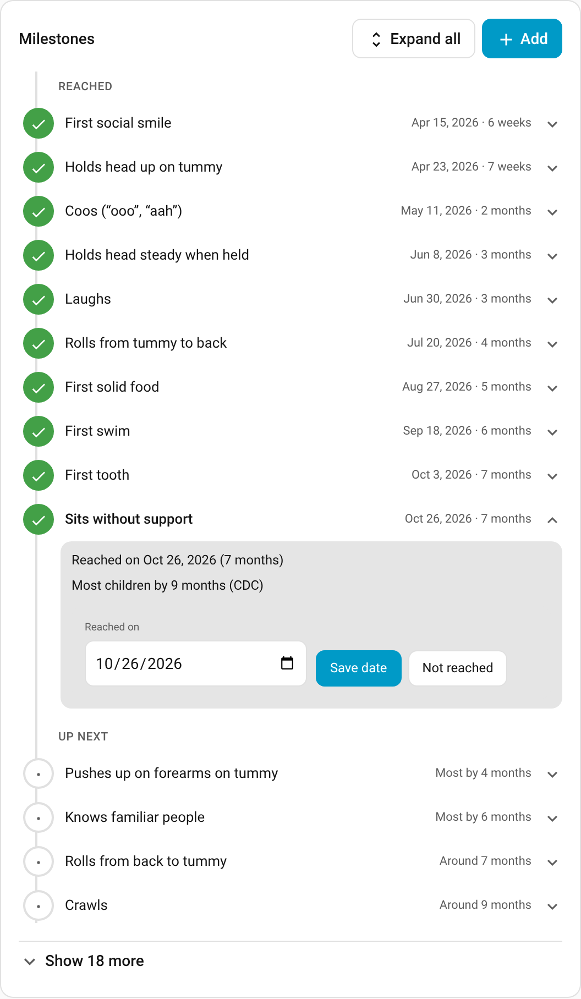
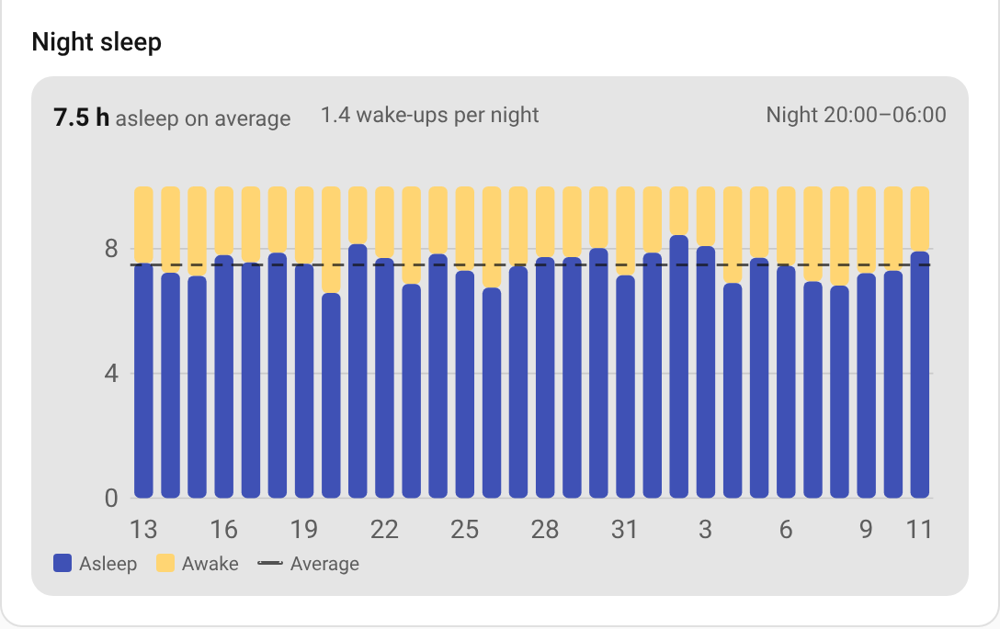
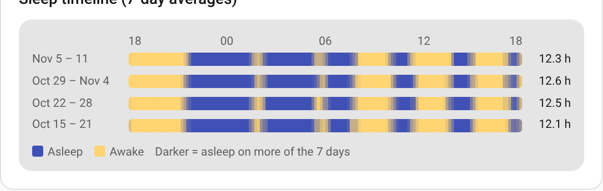

<p align="center">
  
</p>

# Baby Tracker for Home Assistant

[](https://hacs.xyz)
[](https://github.com/Emilhaurum/baby-tracker/actions/workflows/validate.yml)
[](https://github.com/Emilhaurum/baby-tracker/releases)

Track diaper changes, feedings and sleep from Home Assistant: one tap on a dashboard,
a button on your phone's home screen, a watch, a voice assistant or an automation.
Everything is stored locally in Home Assistant.

| Light | Dark |
| --- | --- |
|  |  |

## Features

- **Diapers**: wet, dirty or both, with a count for today.
- **Feedings**: left, right or bottle (with an optional amount in ml). Entries logged
  within the *same feeding window* (45 minutes by default) of the previous one count as
  a side switch in the same feeding, so a feeding can be *Left → Right → Left*. A side
  logged afterwards for a time just before a feeding becomes that feeding's first side. The
  next breast to start with is suggested.
- **Sleep**: tap when the baby falls asleep and when they wake up. Sleeps are kept in an
  editable calendar, so you can add, move or delete them afterwards.
- **Night and daytime sleep**: hours asleep, wake-ups and naps for the last night and
  today, with 7-day averages. You choose when the night starts and ends.
- **Undo**: every action can be undone for 30 seconds.
- **Sleep timeline**: a waterfall chart with one line per day showing when the baby
  slept and was awake. Show as many days as you like, and either every day or an
  average over several days per line (e.g. weekly), which shades each time of day by
  how often the baby is asleep then.
- **Night sleep chart**: hours asleep and awake within the night for each night, with
  the average and wake-ups per night. The night window is the integration's *Night
  starts* / *Night ends* setting, or one you set on the card.
- **Dashboard card** with quick actions, a summary, 7-day trends, night sleep, the
  sleep timeline and an editable log. Choose which parts it shows and in which order, and
  add compact one-tap quick buttons for the phone.
  It is served by the integration, so there is nothing else to install.
- **Growth**: log weight and length now and then and follow them on a chart over the
  baby's age, for years. Metric (kg, cm) or imperial (lb + oz, in).
- **Milestones**: a board of 31 common milestones (holding up their head, rolling,
  sitting, crawling, first word, first steps …) with typical ages, plus your own.
- **Several babies**: add the integration once per baby.
- Logbook entries and a `baby_logger_event` event for every action, for use in automations.

## Installation

### HACS (recommended)

[](https://my.home-assistant.io/redirect/hacs_repository/?owner=Emilhaurum&repository=baby-tracker&category=integration)

1. In HACS, search for **Baby Tracker** and download it.
   If it isn't listed yet, add `https://github.com/Emilhaurum/baby-tracker` as a
   [custom repository](https://hacs.xyz/docs/faq/custom_repositories/) of type *Integration*.
2. Restart Home Assistant.

### Manual

1. Download `baby_logger.zip` from the [latest release](https://github.com/Emilhaurum/baby-tracker/releases/latest).
2. Extract it into `config/custom_components/baby_logger/`.
3. Restart Home Assistant.

Requires Home Assistant 2026.11 or newer. On older releases the dashboard usually shows
*Custom element doesn't exist: baby-logger-card* instead of the bundled card.

## Setup

[](https://my.home-assistant.io/redirect/config_flow_start/?domain=baby_logger)

Go to **Settings → Devices & services → Add integration → Baby Tracker** and enter the
baby's name and, optionally, birth date (used to show the baby's age on the growth chart
and milestones). Repeat for each baby. To rename a baby or change the birth date later,
choose **Reconfigure** on the integration entry.

## Dashboard card

Edit a dashboard, add a card and pick **Baby Tracker**, or add it in YAML:

```yaml
type: custom:baby-logger-card
```

| Option | Default | Description |
| --- | --- | --- |
| `entry_id` | first baby | Which baby to show. The visual editor lets you pick by name. |
| `parts` | see below | The parts to show, in order: `header`, `tiles`, `buttons`, `undo`, `summary`, `trends`, `nights`, `timeline`, `log`, `growth`, `milestones`. When set, the `show_*` options are ignored. |
| `buttons` | all, see below | The quick buttons of the `buttons` part, in order. |
| `buttons_columns` | `3` | Quick buttons per row. |
| `units` | `metric` | Units for growth: `metric` (kg, cm) or `imperial` (lb + oz, in). |
| `growth_entries` | `5` | Measurements listed under the growth charts (0 hides the list). |
| `show_summary` | `true` | Show last night and daytime sleep. |
| `show_trends` | `true` | Show the diaper, feeding and sleep charts. |
| `show_nights` | `true` | Show the night sleep chart. |
| `night_days` | `14` | Nights in the night sleep chart (up to 366). |
| `night_start` / `night_end` | integration's setting | Night window for the chart, e.g. `"20:00"` and `"06:00"`. Leave out to use the *Night starts* / *Night ends* settings of the baby. |
| `show_timeline` | `true` | Show the sleep timeline. |
| `timeline_days` | `14` | Days covered by the sleep timeline (up to 1098). |
| `timeline_group` | `1` | Days per timeline line: `1` shows every day, a larger number (e.g. `7`) averages that many days per line. |
| `timeline_start_hour` | `0` | Hour each timeline line starts at. Use e.g. `18` to keep each night on one line. |
| `show_log` | `true` | Show the latest entries, each with a delete button. |
| `log_entries` | `10` | Number of entries in the log. |
| `days` | `7` | Days shown in the charts (1–31). |

Bottle feeds ask for an optional amount. Tap the ✕ next to a log entry to delete it.

### Layout

`parts` chooses which parts the card shows and in which order:

| Part | Shows |
| --- | --- |
| `header` | The baby's name and today's diaper / feeding counts. |
| `tiles` | The Diaper, Feeding and Sleep tiles with their buttons and the time since each. |
| `buttons` | Compact quick buttons (see below). |
| `undo` | The undo banner, while the latest action can be undone. |
| `summary` | Last night and daytime sleep. |
| `trends` | The 7-day diaper, feeding and sleep charts. |
| `nights` | The night sleep chart. |
| `timeline` | The sleep timeline. |
| `log` | The latest entries. |
| `growth` | Weight and length charts, the latest measurements and a form to add one. |
| `milestones` | The milestone board. |

Without `parts` the card shows `header`, `undo` and `tiles`, followed by the parts turned
on with the `show_*` options, so existing cards look the same. If `undo` isn't listed, the
banner appears above the first `buttons` or `tiles` part (or, without those, above the
first `growth`, `milestones` or `log` part), so an action can always be undone, unless the
quick buttons have their own Undo button.
In the visual editor, tick the parts to show and use the arrows to order them.

### Quick buttons

The `buttons` part is a grid of one-tap buttons, each an icon in a coloured circle with a
label. By default it has a full-width sleep button ("Awake ☀️ – Awake for 2h 10m — tap to
start sleep"), Wet, Dirty and Both, Left, Right and Bottle, and an Undo button that only
appears while the latest action can be undone. The suggested breast is marked *next*, and
within the same-feeding window the feeding buttons say *same feeding*. Bottle opens the
optional amount field.

Each entry in `buttons` takes an `action` and, optionally, a `name`, an `icon`, a `color`
(a Home Assistant colour name such as `light-blue`, or any CSS colour) and `columns` (width in
a 12-column grid: 4 by default, so three per row, and 12 for sleep and undo):

| `action` | Default |
| --- | --- |
| `sleep` | Sleeping 😴 / Awake ☀️, full width |
| `diaper_wet` / `diaper_dirty` / `diaper_both` | Wet (blue), Dirty (brown), Both (orange) |
| `feed_left` / `feed_right` / `feed_bottle` | Left (pink), Right (purple), Bottle (cyan) |
| `undo` | ↩️ Undo, full width, only while an action can be undone |

```yaml
buttons:
  - action: sleep
  - action: diaper_wet
    name: Pee
    color: light-blue
  - diaper_dirty
  - action: feed_left
  - action: feed_right
  - action: undo
```

A compact card for the phone, with just the quick buttons and the sleep summary:

```yaml
type: custom:baby-logger-card
parts: [buttons, summary]
```



A full card with the timeline first:

```yaml
type: custom:baby-logger-card
parts: [header, timeline, buttons, nights, trends, log]
```

### Growth and milestones

Add `growth` and `milestones` to `parts` to show them:

```yaml
type: custom:baby-logger-card
parts: [growth, milestones]
units: imperial   # leave out for metric
```

**Growth**: tap **Add measurement**, pick the date (today by default) and enter the weight,
the length or both. With `units: imperial` the weight is entered as pounds and ounces and the
length in inches; everything is stored in metric, so you can switch units at any time. The
charts show each measurement against the baby's age (or the date, if no birth date is set),
from the first weeks to several years. Tap ✕ next to a measurement to delete it.

**Milestones**: tap a milestone to mark it as reached (today, or pick the date), and tap it
again to change the date or mark it as not reached. Under the board you can add your own,
such as "First swim" (clear its date to add it as not reached yet). Not-yet-reached milestones show a typical age: *Most by 9 months*
is the age by which most children (75%) reach it according to the
[CDC milestone checklists](https://www.cdc.gov/act-early/milestones/index.html);
*Around 6 months* is a typical age for common "firsts" such as the first tooth. Every child
develops at their own pace; these are a guide, not a test. Talk to your doctor if you are
worried.




### More examples

A card with the last 30 nights, counting the night as 20:00–06:00:

```yaml
type: custom:baby-logger-card
show_trends: false
show_timeline: false
show_log: false
night_days: 30
night_start: "20:00"
night_end: "06:00"
```



A card showing four weeks of sleep as weekly averages, with lines running from 18:00 to
18:00 so nights aren't split at midnight:

```yaml
type: custom:baby-logger-card
show_trends: false
show_log: false
timeline_days: 28
timeline_group: 7
timeline_start_hour: 18
```



## Entities

Each baby gets a device with these entities (shown here for a baby called *Alex*):

| Entity | Description |
| --- | --- |
| `sensor.alex_last_diaper` | Time of the last diaper (attribute `type`). |
| `sensor.alex_last_diaper_type` | `wet`, `dirty` or `both`. |
| `sensor.alex_diapers_today` | Diapers since midnight (attributes per type). |
| `sensor.alex_last_feeding` | Start of the last feeding (attributes `side`, `sides`, `amount_ml`, `last_switch`). |
| `sensor.alex_last_feeding_side` | Latest side: `left`, `right` or `bottle`. |
| `sensor.alex_next_feeding_side` | Which breast to start with next. |
| `sensor.alex_feedings_today` | Feedings since midnight (attributes per side). |
| `sensor.alex_bottle_today` | Bottle amount since midnight (ml). |
| `sensor.alex_sleep_today` | Hours slept since midnight, including the current sleep. |
| `sensor.alex_last_night_sleep` | Hours asleep last night, with wake-ups, awake time and 7-night averages. |
| `sensor.alex_daytime_sleep` | Hours asleep during today's daytime, with naps and 7-day averages. |
| `sensor.alex_last_woke_up` | When the baby last woke up. |
| `sensor.alex_weight` | The latest weight (attribute `measured`: its date). Shown in kg, or lb on systems using US customary units. |
| `sensor.alex_length` | The latest length / height (attribute `measured`). Shown in cm, or inches with US customary units. |
| `switch.alex_sleeping` | On while asleep. Turn it on or off to log sleep. |
| `button.alex_diaper_wet` / `_dirty` / `_wet_and_dirty` | Log a diaper. |
| `button.alex_feed_left` / `_right` / `_bottle` | Log a feeding. |
| `button.alex_undo_last_action` | Undo the latest action (available for 30 seconds). |
| `calendar.alex_sleep` | All sleeps. Create, move or delete events to correct them. |
| `number.alex_same_feeding_window` | Minutes within which entries are the same feeding. |
| `time.alex_night_starts` / `time.alex_night_ends` | The night window used for the sleep summary. |

The buttons work well as iOS/Android home screen widgets, on a watch, or with a voice
assistant ("press Feed left").

## Actions

All actions take the baby as `config_entry_id` (pick it in the UI). `time` is optional
and defaults to now, so you can log things after the fact. Times (`time`, `start`, `end`)
can't be in the future.

| Action | Fields |
| --- | --- |
| `baby_logger.log_diaper` | `type` (`wet`, `dirty`, `both`), `time` |
| `baby_logger.log_feeding` | `side` (`left`, `right`, `bottle`), `amount_ml`, `time` |
| `baby_logger.start_sleep` | `time` |
| `baby_logger.end_sleep` | `time` |
| `baby_logger.add_sleep` | `start`, `end` |
| `baby_logger.undo` | |
| `baby_logger.delete_event` | `event_id` |
| `baby_logger.log_growth` | `weight`, `length` (at least one), `units` (`metric`: kg / cm, default; `imperial`: lb / in), `date`, `note` |
| `baby_logger.delete_growth` | `event_id` (the measurement's `id`) |
| `baby_logger.set_milestone` | `milestone` (e.g. `first_steps`, or the id of one you added), `date`, `note` |
| `baby_logger.clear_milestone` | `milestone` |
| `baby_logger.add_milestone` | `name`, `date` (leave out to add it as not reached yet), `note` |
| `baby_logger.delete_milestone` | `milestone` (only ones you added) |

`date` defaults to today and can't be in the future or before the baby's birth date. The
built-in milestone keys are listed in [`milestones.py`](custom_components/baby_logger/milestones.py).

The logging actions return the created entry. For example:

```yaml
action: baby_logger.log_feeding
data:
  config_entry_id: 01JC0EXAMPLE
  side: bottle
  amount_ml: 90
```

### Automation example

Every action fires a `baby_logger_event` with `config_entry_id`, `name`, `action`
(`diaper`, `feeding`, `sleep`, `wake`, `undo`, `delete`, `add_sleep`, `update_sleep`,
`growth`, `delete_growth`, `milestone`, `clear_milestone`, `add_milestone`,
`delete_milestone`) and details such as `type`, `side`, `minutes` or `milestone_name`.

```yaml
triggers:
  - trigger: event
    event_type: baby_logger_event
    event_data:
      action: wake
actions:
  - action: notify.mobile_app_phone
    data:
      message: "{{ trigger.event.data.name }} woke up after {{ trigger.event.data.minutes }} minutes"
```

A reminder when it's been three hours since the last feeding:

```yaml
triggers:
  - trigger: template
    value_template: >
      
      {{ last is not none and now() - last > timedelta(hours=3) }}
actions:
  - action: notify.mobile_app_phone
    data:
      message: "Time to feed Alex (next: {{ states('sensor.alex_next_feeding_side') }})"
```

## Data and privacy

Everything is stored in Home Assistant's `.storage` folder (`baby_logger.<entry id>`) and
is included in Home Assistant backups. Removing a baby deletes its history. Nothing is
sent anywhere. Diagnostics leave out the baby's name.

## Development

```bash
python3.14 -m venv .venv && . .venv/bin/activate
pip install -r requirements_test.txt
pip install home-assistant-frontend   # same version Home Assistant pins
scripts/validate.sh          # lint, version check, card syntax, unit tests
scripts/validate.sh --e2e    # also runs the end-to-end test (needs HA 2026.11+ and Playwright)
```

Run this before pushing. GitHub Actions runs validation on pull requests, weekly
(against the latest Home Assistant) and before a release.

`tests/e2e/` holds an end-to-end test that runs against a real Home Assistant
instance and drives the card in Chromium with Playwright. CI runs it on pull requests
and releases, on the minimum supported and the latest Home Assistant release.

### Releasing

1. `python scripts/set_version.py 1.2.3` and merge that to `main`.
2. On GitHub, open **Actions → Release → Run workflow**, keep `main`, enter `1.2.3` and
   run it. (Pushing a tag works too: `git tag v1.2.3 && git push origin v1.2.3`.)

The release workflow checks that the version matches the manifest, card and
`pyproject.toml`, runs hassfest, HACS validation, linting, the tests and the end-to-end
tests, then creates the `v1.2.3` tag and a GitHub release with `baby_logger.zip` for HACS.

## License

[MIT](LICENSE)
